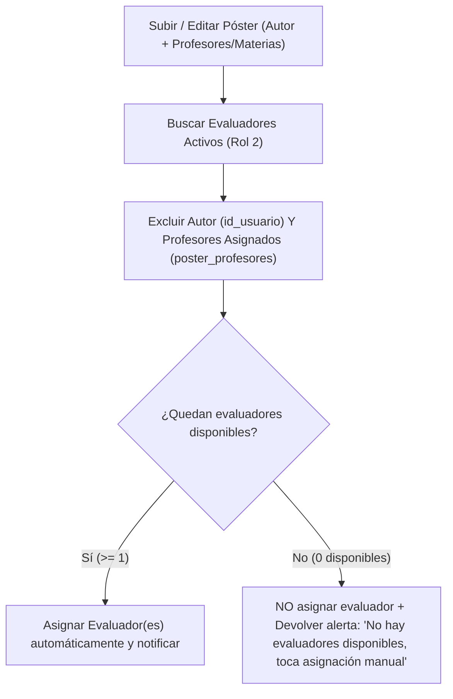

# Plan de Correcciones del Sistema de Pósters

Este plan detalla las causas raíz identificadas en el código actual y los cambios exactos (Backend PHP + Frontend React/CSS) para resolver los **3 requerimientos**.

---

## 1. Numeración continua de pósters entre espacios + Edición y Eliminación de Espacios Físicos

### 1.1. Diagnóstico actual
1. **Reinicio de numeración por espacio**: Actualmente, la subconsulta que calcula el número de puesto (`ubicacion_detallada` / `numero_espacio` / `puesto`) cuenta únicamente los pósters dentro del mismo `id_espacio`:
   ```sql
   SELECT COUNT(*) FROM cargar_posters p2
   WHERE p2.id_espacio = p.id_espacio AND p2.id <= p.id AND p2.activo = 1
   ```
   Esto provoca que al llenarse el Piso 1 (puestos `#1` a `#8`) y pasar al Piso 2, el primer póster del Piso 2 vuelva a numerarse como `#1` en lugar de `#9`.
2. **Falta de edición y eliminación de espacios**:
   - En [`Espacios.php`](backend/api/Espacios.php) solo existen los métodos `GET` (listar), `POST` (crear espacio) y `PUT` (exclusivo para asignar un espacio a un póster). No existe lógica para editar los datos de un espacio ni método `DELETE` para eliminarlo.
   - En [`GestionEspaciosModal.jsx`](src/components/roles/generales/GestionEspaciosModal.jsx) solo se permite crear espacios y ver la tabla, sin botones de editar ni eliminar.

### 1.2. Cambios propuestos

#### A. Numeración consecutiva global por evento (sin reiniciarse al cambiar de espacio)
- **Fórmula SQL unificada**: El número de cada póster ubicado se calculará sumando la **capacidad acumulada de los espacios anteriores del mismo evento** más el **orden del póster dentro de su espacio actual**:
  ```sql
  COALESCE((
      SELECT SUM(e_prev.capacidad)
      FROM espacios_fisicos e_prev
      WHERE e_prev.id_evento = e.id_evento
        AND e_prev.id_espacio < e.id_espacio
  ), 0) + (
      SELECT COUNT(*)
      FROM cargar_posters p2
      WHERE p2.id_espacio = p.id_espacio
        AND p2.id <= p.id
        AND p2.activo = 1
  )
  ```
  > **Ejemplo práctico**: Si el **Piso 1** tiene capacidad máxima de `8`, sus pósters irán del `#1` al `#8`. Al pasar al **Piso 2**, la suma previa es `8`, por lo que el primer póster del Piso 2 será `8 + 1 = #9`, el segundo `#10`, y así sucesivamente en todos los pisos/espacios del evento.

- **Archivos a actualizar con la nueva numeración continua**:
  - [`backend/api/includes/RondasHelper.php`](backend/api/includes/RondasHelper.php): Función central `rh_ubicacion_poster($conexion, $id_poster)`.
  - [`backend/api/TablaPosters.php`](backend/api/TablaPosters.php): Campo `ubicacion_detallada` en `traerPosters()`.
  - [`backend/api/includes/PostersHelper.php`](backend/api/includes/PostersHelper.php): Reemplazar la consulta duplicada en `ph_asignar_evaluadores_al_subir()` llamando directamente a `rh_ubicacion_poster()`.
  - [`backend/api/Notificaciones.php`](backend/api/Notificaciones.php): Cálculo de `numero_espacio` en las notificaciones de pendientes del evaluador.
  - [`backend/api/includes/RecordatoriosHelper.php`](backend/api/includes/RecordatoriosHelper.php): Cálculo de `numero_espacio` en `rec_obtener_pendientes_evaluadores()`.

#### B. Modificar y Eliminar Espacios Físicos (Admin y Super Admin)
- **Backend — [`backend/api/Espacios.php`](backend/api/Espacios.php)**:
  1. **Editar espacio (`PUT` cuando `accion === 'editar_espacio'`)**:
     - Exigir rol Admin o Super Admin (`require_role([3, 4])`).
     - Si es Admin de evento (`rol 3`), verificar que el espacio pertenezca a su evento (`auth_id_evento_admin`).
     - Validar que la nueva `capacidad` sea `>= ocupacion_actual` (no permitir reducir la capacidad por debajo de la cantidad de pósters que ya están ocupando ese espacio).
     - Actualizar `nombre_espacio`, `capacidad` (y `id_evento` si es Super Admin).
  2. **Eliminar espacio (`DELETE`)**:
     - Exigir rol Admin o Super Admin (`require_role([3, 4])`) y validar pertenencia al evento del Admin.
     - Si el espacio tiene pósters activos asignados, desasignarlos (`UPDATE cargar_posters SET id_espacio = NULL WHERE id_espacio = ?`) dentro de una transacción antes de eliminar el registro en `espacios_fisicos` (informando cuántos pósters quedaron sin ubicación para ser reubicados).
- **Frontend — [`src/components/roles/generales/GestionEspaciosModal.jsx`](src/components/roles/generales/GestionEspaciosModal.jsx)**:
  - Añadir columna **Acciones** en la tabla de espacios con botones **✏️ Editar** y **🗑️ Eliminar**.
  - Al pulsar **Editar**, cargar los datos del espacio en el formulario lateral (`nombre_espacio`, `capacidad`, `id_evento`), cambiando el título a *"Editar Espacio Físico"* con botones **Guardar Cambios** y **Cancelar**.
  - Al pulsar **Eliminar**, pedir confirmación (advirtiendo si el espacio tiene pósters ocupados) y llamar a `DELETE /Espacios.php`.

---

## 2. Prohibición estricta de asignar o calificar pósters al autor o a los profesores asignados

### 2.1. Diagnóstico actual
1. **Fallback indebido en asignación automática**: En [`PostersHelper.php` (líneas 697-710)](backend/api/includes/PostersHelper.php), `ph_asignar_evaluadores_al_subir()` separa a los evaluadores en `$preferidos` (no profesores del póster) y `$respaldo` (profesores del póster), pero luego ejecuta:
   ```php
   $pool = array_merge($preferidos, $respaldo);
   ```
   Si no hay otros evaluadores disponibles, **toma los de `$respaldo` y asigna al propio profesor del póster como evaluador**.
2. **Asignación manual sin filtro de profesores**: En [`AsignarEvaluadores.php`](backend/api/AsignarEvaluadores.php), tanto el `GET` como el `POST` excluyen únicamente al autor (`cargar_posters.id_usuario`), pero **permiten** listar y asignar manualmente a los profesores vinculados al póster en `poster_profesores`.
3. **Elegibilidad de evaluación incompleta**: En [`RondasHelper.php`](backend/api/includes/RondasHelper.php), `rh_elegibilidad()` y `rh_elegibilidad_lote()` solo verifican `rh_es_autor_poster()`, sin comprobar si el evaluador figura en `poster_profesores`.
4. **Sorteos de Ronda 2+ y Recordatorios**:
   - En [`RondasHelper.php` (`rh_reasignar_aleatorio_ronda`)](backend/api/includes/RondasHelper.php) y [`RecordatoriosHelper.php` (`rec_ejecutar_reasignar_pendientes`)](backend/api/includes/RecordatoriosHelper.php) no se excluye `poster_profesores`.
   - En [`RecordatoriosHelper.php` (`rec_ejecutar_asignar_huerfanos`, líneas 415-425)](backend/api/includes/RecordatoriosHelper.php), los parámetros enviados a `ph_asignar_evaluadores_al_subir()` están en orden incorrecto.

### 2.2. Cambios propuestos



1. **Exclusión estricta en asignación automática — [`backend/api/includes/PostersHelper.php`](backend/api/includes/PostersHelper.php)**:
   - Eliminar por completo el arreglo `$respaldo`.
   - Excluir en la consulta SQL de `ph_asignar_evaluadores_al_subir()` tanto al autor (`u.id <> ?`) como a cualquier profesor registrado en `poster_profesores` para ese póster (`AND NOT EXISTS (SELECT 1 FROM poster_profesores pp WHERE pp.id_poster = ? AND pp.id_usuario = u.id)`) además de cualquier ID en `$idsProfesores`.
   - Si tras filtrar no queda ningún evaluador disponible (`empty($preferidos)`), **no asignar ningún evaluador** y retornar:
     ```php
     'sin_evaluadores_disponibles' => true,
     'mensaje_sin_evaluador' => 'No se registró evaluador porque no hay evaluadores disponibles (los disponibles son quienes subieron el póster o figuran como profesores asignados). Se requiere asignación manual.'
     ```
2. **Aviso claro al subir el póster — [`backend/api/SubirPosters.php`](backend/api/SubirPosters.php) y [`src/components/formularios/CargarPosters.jsx`](src/components/formularios/CargarPosters.jsx)**:
   - En `SubirPosters.php`, incluir `sin_evaluadores_disponibles` y `mensaje_sin_evaluador` dentro de `poster` en la respuesta JSON (y ajustar el texto del correo al autor para que no diga que ya se asignó evaluador si quedó pendiente de asignación manual).
   - En `CargarPosters.jsx`, si `data.poster?.evaluadores_asignados` está vacío o `sin_evaluadores_disponibles` es `true`, mostrar en la alerta de confirmación:
     > *"⚠️ No se registró evaluador porque no hay disponibles (los disponibles son los mismos que subieron el póster o sus profesores asignados). Toca asignación manual."*
3. **Bloqueo en asignación manual — [`backend/api/AsignarEvaluadores.php`](backend/api/AsignarEvaluadores.php) y [`src/components/roles/generales/AsignarEvaluadorModal.jsx`](src/components/roles/generales/AsignarEvaluadorModal.jsx)**:
   - En `AsignarEvaluadores.php` (`GET`): excluir de la consulta SQL a los usuarios que estén en `poster_profesores` para ese `id_poster`, y devolver `ids_profesores` y `profesores_excluidos` en el JSON.
   - En `AsignarEvaluadores.php` (`POST`): verificar en base de datos que ningún ID en `evaluadores_ids` sea el autor ni aparezca en `poster_profesores` para ese póster; si aparece, responder HTTP 400 con mensaje de conflicto de intereses.
   - En `AsignarEvaluadorModal.jsx`: mostrar en el resumen superior los profesores asignados (indicando que están excluidos por conflicto de interés) y, si la lista de evaluadores disponibles queda vacía, mostrar el aviso de que no hay evaluadores disponibles distintos al autor/profesores asignados.
4. **Bloqueo al calificar y en sorteos/recordatorios — [`RondasHelper.php`](backend/api/includes/RondasHelper.php), [`TablaPosters.php`](backend/api/TablaPosters.php) y [`RecordatoriosHelper.php`](backend/api/includes/RecordatoriosHelper.php)**:
   - Agregar `rh_es_profesor_poster($conexion, $id_poster, $id_usuario)` en `RondasHelper.php`.
   - En `rh_elegibilidad()` y `rh_elegibilidad_lote()`: bloquear la evaluación si el evaluador es autor **o** profesor asignado del póster (`"No puedes evaluar un póster en el que figuras como profesor asignado (conflicto de intereses)."`).
   - En `rh_participantes_ronda()`, `rh_reasignar_aleatorio_ronda()`, `rec_ejecutar_reasignar_pendientes()`, `rec_obtener_pendientes_evaluadores()` y `Notificaciones.php`: excluir siempre a quienes figuren en `poster_profesores` para ese póster.
   - En `rec_ejecutar_asignar_huerfanos()`: corregir el orden de argumentos al invocar `ph_asignar_evaluadores_al_subir()`.
   - En `TablaPosters.php` (`modificarPoster`): si al editar un póster se agregan profesores en `poster_profesores`, eliminar cualquier asignación pendiente en `asignaciones_evaluadores` que coincida con esos profesores (y no tenga calificación registrada).

---

## 3. Tamaño adecuado del botón «Publicar nuevo póster» en Evaluador (Escritorio y Móvil)

### 3.1. Diagnóstico actual
1. En [`src/components/formularios/Formulario.css` (líneas 236-249)](src/components/formularios/Formulario.css), la clase `.boton-primario` tiene `width: 100%` declarada de forma **global** (sin estar acotada a `.formularios .boton-primario`).
2. Como [`HomePageEvaluador.jsx`](src/components/roles/evaluador/HomePageEvaluador.jsx) importa `CargarPosters.jsx` (el cual importa `Formulario.css`), el botón `+ Publicar nuevo póster` en la sección **Mis Pósters Publicados** ([`HomePageEvaluador.jsx` L265-L271](src/components/roles/evaluador/HomePageEvaluador.jsx)) toma `width: 100%` y se estira ocupando todo el ancho de la pantalla en escritorio.
3. Adicionalmente, el botón superior `.btn-cargar-posters` en el hero ([`HomePageEvaluador.jsx` L133-L138](src/components/roles/evaluador/HomePageEvaluador.jsx) y [`HomePageUsuario.jsx` L52-L57](src/components/roles/usuario/HomePageUsuario.jsx)) no tiene estilos propios en [`roles.css`](src/components/roles/generales/roles.css).

### 3.2. Cambios propuestos
- **[`src/components/formularios/Formulario.css`](src/components/formularios/Formulario.css)**:
  - Acotar `width: 100%` exclusivamente a los botones dentro de tarjetas de formulario (`.formularios .boton-primario`, `.formularios .boton-secundario`), evitando que `.boton-primario` fuerce `width: 100%` en las páginas de los roles.
- **[`src/components/roles/generales/roles.css`](src/components/roles/generales/roles.css) y [`src/components/roles/evaluador/HomePageEvaluador.jsx`](src/components/roles/evaluador/HomePageEvaluador.jsx)**:
  - Estilizar `.btn-cargar-posters` y `.btn-publicar-poster` (o `.posters-publicados .boton-primario`) con dimensiones proporcionadas:
    - **Escritorio**: `width: auto`, `max-width: 260px`, `padding: 0.7rem 1.4rem`, `font-size: 0.95rem`, `display: inline-flex`, `align-items: center`, `justify-content: center`, `gap: 0.45rem`, centrado en su contenedor.
    - **Móvil (`@media (max-width: 640px)`)**: `width: auto`, `min-width: 200px`, `max-width: calc(100% - 2rem)`, `padding: 0.68rem 1.25rem`, `font-size: 0.9rem`, para que se vea compacto, centrado y cómodo de pulsar sin ocupar toda la pantalla.
